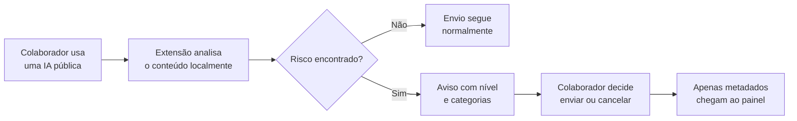
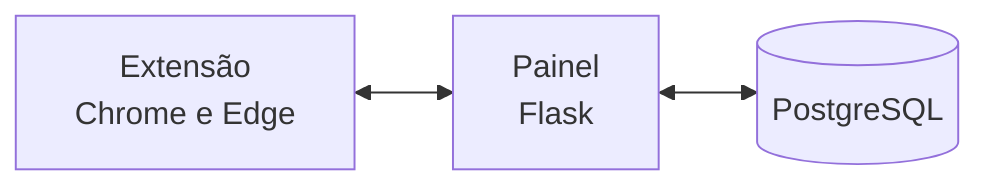

<div align="center">


# Sentinela

**Governança e letramento em IA para o uso corporativo de ferramentas generativas**

*O que é confidencial não deveria virar prompt.*

Versão **4.5.0** · Extensão para Chrome e Edge · Flask · PostgreSQL

[Baixar a extensão](./public/sentinela-extensao.zip) · [Baixar o projeto](./public/sentinela-projeto.zip) · [Como funciona](#como-funciona) · [Instalação](#instalação-da-extensão)

</div>

---

## Visão geral

O Sentinela é uma camada de governança para o uso de IAs públicas no trabalho. A extensão identifica dados sensíveis no conteúdo que será enviado e exibe um aviso educativo antes do envio. O painel administrativo recebe apenas os metadados do alerta e transforma as decisões em indicadores de letramento.

| Público | O que recebe |
| --- | --- |
| **Colaborador** | Um aviso curto no momento do risco, com nível, categorias e orientação. |
| **Empresa** | Visibilidade dos departamentos que mais expõem dados e onde o aviso ainda não funciona. |

## Principais recursos

- **Análise local:** texto digitado, colagens, imagens e PDFs são processados no navegador, antes do envio.
- **Aviso contextual:** o nível de risco é calculado pela regra mais grave encontrada e exibido no próprio campo de texto.
- **Auditoria sem conteúdo:** o painel registra IA, departamento, colaborador, origem, nível, categorias e decisão — nunca o texto, a imagem ou o PDF.
- **Letramento:** compara envios e cancelamentos por departamento e destaca onde o aviso precisa ser reforçado.
- **Indicadores para a gestão:** vazamentos evitados, taxa de envio após alerta, mapa de risco por departamento e origem do conteúdo (texto, colagem, imagem e PDF).
- **Gestão centralizada:** regras, departamentos, mensagens, IAs autorizadas e dispositivos são controlados no painel e sincronizados com as extensões.
- **Privacidade por design:** o conteúdo é analisado no próprio navegador e descartado; não é armazenado no servidor.

## Como funciona



1. O colaborador usa uma IA pública com texto, imagem ou PDF.
2. A extensão analisa o conteúdo localmente e aplica as regras ativas.
3. Se houver risco, o aviso aparece antes do envio com o nível e as categorias encontradas.
4. O colaborador decide enviar ou cancelar. Apenas o registro do alerta é enviado ao painel.

Em risco médio ou alto, o envio pede confirmação. O Sentinela orienta, mas **não bloqueia** a decisão do colaborador.

## Extensão

| Item | Informação |
| --- | --- |
| **Versão** | 4.5.0 |
| **Navegadores** | Chrome e Edge (Manifest V3) |
| **Permissões** | `storage`, `offscreen`, `alarms`, `scripting` |
| **Acesso a sites** | `https://*/*`, limitado às IAs autorizadas no painel |
| **Análise** | Local, sem envio do conteúdo ao servidor |

A permissão `offscreen` permite extrair texto de imagens e PDFs em uma página isolada da extensão. `alarms` mantém a sincronização e a fila de reenvio; `scripting` injeta o detector nas IAs adicionadas pelo painel. A sincronização baixa a matriz completa apenas quando a configuração muda.

### Instalação

1. Baixe o ZIP pelo painel ou pelo link acima e extraia o arquivo.
2. Abra `chrome://extensions` ou `edge://extensions` e ative o **Modo do desenvolvedor**.
3. Escolha **Carregar sem compactação** e selecione a pasta `extensao`.
4. Nas **Opções**, cole o código de conexão fornecido pelo administrador.
5. Informe o departamento, o identificador do colaborador e use **Testar conexão**.

O código completo já inclui o endereço do servidor. Após atualizar o projeto, recarregue a extensão em `chrome://extensions` para que o navegador exiba a versão 4.5.0.

## Painel administrativo

| Tela | O que centraliza |
| --- | --- |
| **Visão geral** | Indicadores (total de alertas, alto risco, taxa de envio e departamentos críticos), evolução dos alertas, vazamentos evitados, departamento por nível, envios após o aviso por semana, origem do conteúdo e efetividade por departamento. |
| **Alertas** | Filtros por data, departamento e nível, paginação e exportação em CSV ou PDF. |
| **Regras e departamentos** | Criação, edição, ativação e exclusão de regras; matriz de risco por área. |
| **Monitoramento** | Monitoramento geral, IAs autorizadas, dispositivos conectados, código de conexão e download da extensão. |
| **Administradores** | Contas de acesso, troca de senha e histórico de alterações administrativas. |

O indicador central de letramento é o **“enviou mesmo assim”**. Muitos cancelamentos indicam que o aviso está funcionando; muitos envios em risco alto indicam necessidade de treinamento, contexto ou uma ferramenta corporativa autorizada. Em paralelo, **Vazamentos evitados** mostra quantos alertas de risco alto e médio foram cancelados depois do aviso, com a porcentagem ao lado da contagem — o indicador que traduz o valor do produto para a diretoria.

Os mesmos dados atendem a leituras diferentes: a diretoria acompanha vazamentos evitados, tendência e variação; a segurança revisa alertas pendentes, tipos de dado e cobertura; o jurídico/LGPD usa os tipos de dado e o relatório exportável; o RH vê envios por semana e departamentos críticos. Todas as telas têm estados de carregamento (esqueletos) e estados vazios explicativos, para não confundir ausência de dados com ausência de risco.

## Privacidade e segurança

- O conteúdo é analisado no navegador e **não é armazenado**.
- O painel recebe apenas metadados: IA, departamento, colaborador, origem, nível, categorias e decisão.
- O acesso ao painel é protegido por login e sessão de duração limitada.
- O código de conexão autoriza a extensão a registrar alertas, mas não concede acesso ao painel.
- A matriz completa de regras fica restrita à API autenticada da extensão.

## Arquitetura



| Camada | Tecnologia |
| --- | --- |
| **Extensão** | Manifest V3, JavaScript puro e Shadow DOM |
| **Painel** | Flask, Jinja, HTML e CSS |
| **Banco de dados** | PostgreSQL (Neon) |
| **Hospedagem** | Render |
| **Automação** | GitHub Actions |

A landing oficial é servida pelo Flask em `servidor/templates/landing.html`. Na prévia do Freebuff, o Vite encaminha a raiz para o próprio Flask, então o navegador mostra exatamente a mesma página que será publicada — não existe uma segunda versão da landing.

### Prévia local

O preview do Vite inicia o painel Flask real com um PostgreSQL embutido e dados de demonstração. Consulte [`DEPLOY.md`](./DEPLOY.md) para a publicação.

```bash
bun install
bun run dev
```

Acesse `/painel` e entre com `admin` / `admin123` no ambiente de prévia. A extensão continua precisando de um servidor HTTPS público para testar o fluxo completo.

## Documentação e suporte

- [Guia de deploy](./DEPLOY.md)
- [Gerar os ZIPs de download](./scripts/gerar_zips.py)
- [Extensão para download](./public/sentinela-extensao.zip)
- [Projeto completo](./public/sentinela-projeto.zip)

## Licença

Projeto pessoal de portfólio. Consulte o autor antes de qualquer reutilização comercial.
