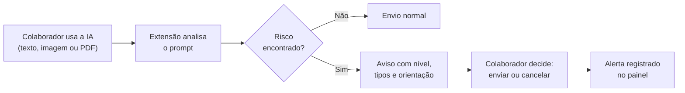
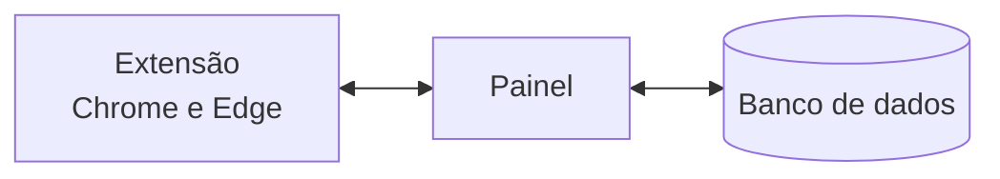

# Sentinela

**Governança e letramento em IA para o uso de inteligências artificiais no trabalho**

*O que é confidencial não deveria virar prompt.*

Versão 2.9 · Extensão para Chrome e Edge

[Baixar a extensão](./public/sentinela-extensao.zip) · [Como funciona](#como-funciona) · [Instalação](#instalação-da-extensão)

---

## Visão geral

O Sentinela é uma camada de governança para o uso de IAs públicas no trabalho. Ele ajuda a empresa a perceber quando informações sensíveis estão prestes a ser enviadas para ferramentas como ChatGPT, Gemini, Claude e Copilot, e faz isso sem armazenar o conteúdo das conversas.

Uma **extensão para Chrome e Edge** analisa o prompt diretamente no chat e exibe um aviso antes do envio. Um **painel administrativo** recebe apenas o alerta e transforma as decisões dos colaboradores em indicadores de letramento.

| Para quem | O que o Sentinela entrega |
| --- | --- |
| **Colaborador** | Um aviso curto e educativo, no momento exato em que o risco existe. |
| **Empresa** | Visibilidade de quais departamentos expõem mais dados e de onde o aviso ainda não funciona. |

## O problema

As pessoas querem automatizar tarefas simples, e a IA virou o caminho mais rápido. O risco é que, junto com a tarefa, seguem dados confidenciais. Situações comuns:

- Colar um trecho de código com uma chave de acesso para pedir ajuda com um erro.
- Enviar um contrato inteiro para a IA resumir.
- Colar uma planilha de RH com CPFs e salários para "organizar" os dados.

Os controles tradicionais não enxergam isso. Antivírus e firewall inspecionam arquivos e tráfego de rede, não o significado do que é digitado em uma conversa. A empresa só descobre o vazamento depois, se descobrir, e sem registro de quem enviou, com que risco e em qual departamento, a política de uso de IA fica só no papel.

## A solução

O Sentinela torna esse risco visível no momento certo:

- **Avisa antes do envio**, não depois do incidente.
- **Ensina** o colaborador com uma mensagem curta e objetiva.
- **Registra a decisão** (enviar ou cancelar) para a empresa acompanhar o letramento.
- **Controla o risco, não a conversa**: o conteúdo é analisado diretamente no chat e não é guardado.

## Destaques

| Recurso | Descrição |
| --- | --- |
| **Análise local** | Texto digitado, colagens, imagens e PDFs são analisados diretamente no chat, antes do envio. |
| **Imagens e PDFs** | O texto é extraído por OCR em um contexto isolado da extensão e classificado. A imagem não é guardada em nenhum momento. |
| **Colagens grandes** | A colagem é analisada antes de chegar ao site, com classificação própria para blocos longos, listas e código. |
| **Regras técnicas embutidas** | Validação de CPF, CNPJ e cartões, tokens, senhas e código-fonte já vêm prontos na extensão. |
| **Matriz editável** | Regras, departamentos e mensagens educativas ajustáveis no painel, em português e inglês. |
| **Sincronização automática** | Alterações no painel chegam a todas as extensões em até 1 minuto. |
| **Auditoria sem conteúdo** | Registro dos alertas com filtros, retenção e exportação em CSV e PDF. |
| **Letramento por departamento** | Compara envios e cancelamentos e destaca os departamentos críticos. |
| **Gestão centralizada** | Ativação, IAs monitoradas e dispositivos conectados controlados em um só lugar. |
| **Resiliência** | Uma fila local reenvia os alertas quando o servidor ou a rede ficam indisponíveis. |

## Como funciona

### Níveis do aviso

| Nível | Quando aparece | O que o colaborador vê |
| --- | --- | --- |
| **Alto** | Há dados confidenciais ou sensíveis. | “Remova os dados sensíveis antes de enviar.” |
| **Médio** | Há dados internos da empresa. | “Compartilhe só o necessário e confira a política de uso de IA antes de enviar.” |
| **Baixo, com detecções** | Há dados de baixo risco. | “Vale uma revisão rápida antes de enviar.” |
| **Sem detecções** | Nada sensível foi encontrado. | “Nenhum dado sensível detectado.” |

Em risco médio ou alto, o envio pede confirmação. O Sentinela orienta e pede confirmação; **não bloqueia** a decisão do colaborador.

### Matriz de risco

Cada regra pertence a um **departamento** e a um **nível** (baixo, médio ou alto). O maior nível encontrado define o alerta: um item de risco alto eleva a mensagem a risco alto; sem itens altos, um item médio eleva a risco médio.

O mesmo cadastro de departamentos classifica as regras e identifica onde o colaborador trabalha, o que permite cruzar risco e letramento por área da empresa.

| Departamento | Exemplos de risco alto | Exemplos de risco médio |
| --- | --- | --- |
| **Financeiro** | Faturamento, dados bancários da empresa, previsão de resultados | Valor de despesa, orçamento interno, nota fiscal ou pedido |
| **Jurídico** | Valor de contrato, cláusulas contratuais, processo judicial | Número de contrato |
| **Projetos e Estratégias** | Produto não lançado, estratégia de negócio, precificação ou proposta | Nome de projeto interno, cronograma de projeto |
| **RH** | CPF, salário, dados bancários, documento de identidade, dados de saúde | Data de nascimento, endereço residencial, avaliação de desempenho |
| **Segurança da Informação** | Código de verificação ou MFA, dump ou backup de banco, dados de clientes, acesso remoto ou VPN | Documento confidencial, relatório de vulnerabilidade, arquivo de ambiente |
| **TI** | Senha ou credencial, token ou chave de API, chave privada, string de conexão, código-fonte interno | Sem regras neste nível |

O Sentinela vem com mais de 40 regras iniciais, incluindo validações técnicas de CPF, CNPJ e cartões. Regras, departamentos, mensagens e o limite de criticidade podem ser ajustados no painel, e novas regras podem ser criadas por palavra-chave ou expressão regular (regex).

### Sincronização

A extensão consulta periodicamente a versão da configuração e baixa a matriz completa apenas quando uma regra, departamento, mensagem ou política muda. As alterações chegam às extensões em até 1 minuto.

## Painel administrativo

| Tela | O que oferece |
| --- | --- |
| **Visão geral** | Indicadores, evolução dos alertas, distribuição por risco, decisão após o aviso, IAs com mais alertas, risco alto por departamento, tipos mais detectados e efetividade dos avisos. |
| **Alertas** | Auditoria com filtros por data, departamento e nível, retenção e exportação em CSV e PDF. |
| **Regras de detecção** | Busca, criação, edição, ativação e exclusão de regras. |
| **Departamentos** | Matriz de risco e regras de cada departamento. Ao excluir um departamento, o histórico de alertas é preservado. |
| **Mensagens educativas** | Textos exibidos no aviso para risco alto, médio, baixo com detecções e sem detecções. |
| **Monitoramento** | Ativação geral, IAs monitoradas, dispositivos conectados, código de verificação e download da extensão. |
| **Administradores** | Contas com acesso ao painel. O superadmin cria e exclui administradores; contas comuns trocam a própria senha. O histórico de atividades recentes mostra quem alterou regras, mensagens, alertas e configurações. |

### Letramento

O indicador central é o **"enviou mesmo assim"**. O painel compara envios e cancelamentos por departamento, não para punir, mas para mostrar onde o aviso ainda não funciona e onde o letramento precisa ser reforçado.

| Situação | Critério |
| --- | --- |
| **Crítico** | Ao menos 3 alertas, com percentual de risco alto igual ou acima do limite de criticidade. |
| **Em observação** | Menos de 3 alertas. |
| **Normal** | Ao menos 3 alertas, com percentual de risco alto abaixo do limite. |

O limite de criticidade é configurável na **Visão geral**.

> **Como ler:** muitos cancelamentos indicam que o aviso está funcionando. Muitos envios em risco alto indicam que o aviso precisa de contexto, treinamento ou uma ferramenta corporativa autorizada.

### Dispositivos e acessos

- Cada instalação da extensão aparece no painel com colaborador, departamento, IP e situação do código, e pode ser desconectada individualmente.
- Ao renovar o código de verificação, cada dispositivo volta a conectar assim que o novo código é salvo nas Opções da extensão, sem reinstalar.
- A política é central: a ativação e as IAs monitoradas são definidas no painel e valem para todos os computadores. As Opções da extensão guardam apenas o que é específico de cada máquina: código de verificação, departamento e identificador do colaborador.
- O primeiro administrador criado pelo servidor é o **superadmin**. Ele não pode ser excluído e é o único que cria e exclui outros administradores. Contas comuns trocam a própria senha.

## Privacidade e segurança

> **Nenhum conteúdo é armazenado.** Texto, imagens e PDFs são analisados diretamente no chat.

### O que chega ao painel

Apenas o registro do alerta: a IA utilizada, o departamento, o colaborador, o IP, a origem do conteúdo (texto, imagem ou PDF), o nível de risco, os tipos de dado detectados e a decisão de enviar ou cancelar.

### Controle de acesso

- O painel é de uso exclusivo de administradores autorizados, com login e sessão de duração limitada.
- As contas de administrador são criadas somente pelo superadmin.
- O código de verificação autoriza a extensão a registrar alertas, mas não dá acesso ao painel.

## Arquitetura e tecnologias

A extensão envia os alertas ao painel e recebe as regras e a configuração.

| Camada | Tecnologia |
| --- | --- |
| **Extensão** | Manifest V3 (Chrome e Edge), JavaScript puro e Shadow DOM |
| **Painel** | Flask (Python), Jinja, HTML e CSS |
| **Banco de dados** | Postgres (Neon) |
| **Hospedagem** | Render |
| **Automação** | GitHub Actions |

### Como a detecção funciona

A extensão acompanha o campo de texto das IAs e aplica as regras localmente. O aviso é exibido isolado do estilo do site, e imagens e PDFs passam pelo mesmo conjunto de regras depois de terem o texto extraído.

Cada regra do painel pode ser uma **palavra-chave** ou uma **expressão regular (regex)**. Além delas, a extensão traz regras técnicas embutidas, como a validação de CPF, CNPJ e cartões.

## Instalação da extensão

Cada colaborador instala a extensão no próprio Chrome ou Edge. O administrador fornece o código de verificação; o download feito pelo painel já inclui o endereço do servidor.

1. O administrador fornece o código de verificação. Para testes sem o painel, há também o [ZIP público](./public/sentinela-extensao.zip).
2. O arquivo é extraído em uma pasta de fácil acesso.
3. A página de extensões do Chrome é `chrome://extensions`, e a do Edge é `edge://extensions`.
4. Nessa página, o **Modo do desenvolvedor** é ativado.
5. Com a opção **Carregar sem compactação**, é selecionada a pasta `extensao`.
6. Nas **Opções** da extensão, é informado apenas o código de verificação recebido. A URL do servidor é definida pela configuração entregue no download do painel.
7. Em seguida, são escolhidos o departamento e o identificador do colaborador.
8. Ao salvar, a autorização de acesso ao servidor é confirmada, se solicitada, e o botão **Testar conexão** verifica a ligação.
9. Por fim, um teste com um dado fictício no ChatGPT, Gemini, Claude ou Copilot confirma que o aviso aparece.

## Licença

Projeto pessoal de portfólio. Entre em contato antes de qualquer reutilização comercial.
